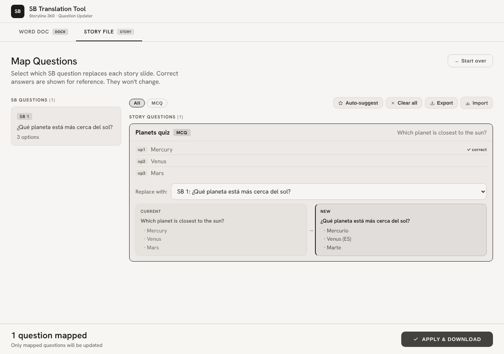

[](https://github.com/parthdhanani/sb-translation-tool/actions/workflows/ci.yml)

# SB Translation Tool

Pushes translated question text straight into an Articulate Storyline 360 storyboard — no manual copy-paste across dozens of slides per language.

Upload the original PPTX storyboard alongside a translated Word doc (or a `.story` file directly), and the tool matches questions between the two, lets you review/adjust the mapping, then writes the translated text back into the file for re-import.

Born from doing this by hand across six languages on a production SCORM pipeline.

## Two workflows

- **PPTX + Word doc** → matches storyboard questions in the PPTX against a translated Word document, applies the mapping, outputs an updated `.docx`.
- **PPTX + `.story` file** → matches directly against a Storyline `.story` project file, outputs an updated `.story` ready to reopen in Storyline.

## Screenshot

The `.story` workflow's mapping step with a small synthetic storyboard and `.story` (the same fixtures the test suite builds), after **Auto-suggest**:



## Install

```bash
pip install -r requirements.txt
```

## Usage

```bash
python app.py            # dev server on 127.0.0.1:5050 (PORT env var to change)
# production: gunicorn app:app --bind 0.0.0.0:5050
```

Open the page, pick a workflow tab, upload both files, review the question mapping (Auto-suggest matches by text similarity; mappings can be exported/imported as JSON), then **Apply & download** the updated file.

The same flow is scriptable over HTTP:

```bash
SID=$(curl -s -F pptx=@storyboard_es.pptx -F story=@course.story localhost:5050/scan-story | jq -r .session_id)
curl -s -H 'Content-Type: application/json' localhost:5050/apply-story \
  -d "{\"session_id\":\"$SID\",\"mappings\":[{\"story_slide_file\":\"story/slides/slide1.xml\",\"pptx_id\":1}]}"
curl -s -o updated_course.story localhost:5050/download-story/$SID
```

## Testing

```bash
pip install -r requirements-dev.txt
ruff check .
python -m pytest -v
```

The suite is offline and self-contained: `tests/fixtures.py` builds a tiny synthetic PPTX, SingleTable DOCX export and `.story` archive at test time. It covers both parsers, Word and `.story` write-back (scoring flags and `opN` labels preserved, input never modified), the full upload → apply → download flow for both workflows, input/session validation, and the 1 GB unpacked-size guard on `.story` archives (tested by lowering the limit, not with a real 1 GB file). CI runs ruff + pytest on every push and PR.

## Architecture

```
app.py            Flask routes: /scan + /apply + /download (Word), /scan-story + /apply-story + /download-story
parser.py         PPTX question extraction; Word export parsing (paired-table + SingleTable formats) and write-back
story_parser.py   .story (ZIP) parsing and streamed write-back via targeted regex over slide XML
templates/        single-page UI (upload, mapping review, apply)
tests/            pytest suite + synthetic fixture builders
```

Each upload gets a UUID session directory under `/tmp/sb_tool_sessions` (30-minute TTL, 15-session cap, 80 MB per file, ZIP magic-byte check). Session ids are validated as UUIDs before touching the filesystem. `.story` output is always written to a new file; the original is never modified.

## Stack

Flask · `python-pptx` · `python-docx` · gunicorn

## Contributing

See [CONTRIBUTING.md](CONTRIBUTING.md).
